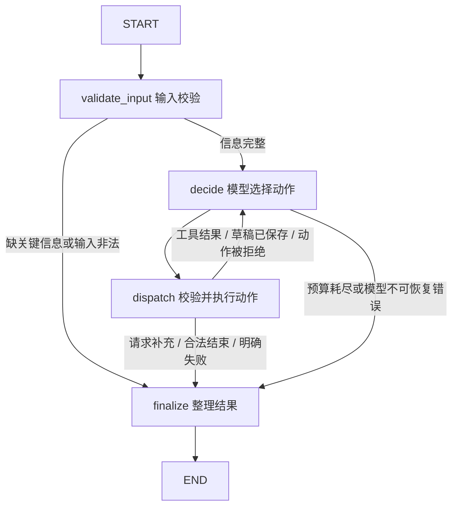

# 短视频脚本 Agent 框架设计

本文是实现方案，尚无可运行代码、真实模型执行记录或测试结果。

## 1. 范围与技术选择

- Python + LangGraph StateGraph：表达共享状态、工具执行和决策循环。
- Pydantic：校验用户输入、模型动作、脚本及工具结果。
- 模型适配层：接入一个支持结构化输出的模型；供应商、模型名和凭证通过配置指定。
- CLI：第一版运行入口，输入和结果使用 JSON，脚本额外导出 Markdown。
- pytest：验证工具、交付门禁、异常路径和离线流程。
- 本地 JSON 素材与品牌规则：第一版不引入向量数据库、联网搜索或 Web 服务。

采用一个决策 Agent。写稿与改稿在同一个模型决策入口完成，避免多个 Agent 引入额外协调成本。模型调用封装在适配层，LangGraph 不直接依赖具体供应商。

## 2. 图结构



`decide` 每次读取最新素材、草稿、检查报告和工具错误，生成一个结构化动作。条件边只负责执行已选择的动作和落实硬性限制，不代替模型选择业务策略。

`dispatch` 是自定义动作执行器：它既能调用业务工具，也能保存模型提交的草稿。第一版每轮只允许一个动作，便于精确计数和审计。

## 3. 模型动作协议

以 Pydantic discriminated union 校验以下动作；`action` 是判别字段。每个动作另带简短 `reason`，只记录可公开的决策依据。

| action | 参数 | 执行结果 |
| --- | --- | --- |
| search_materials | query、可选 product_id | 返回素材、事实及检索摘要 |
| save_draft | 完整 ScriptDraft、可选 base_revision | 新建版本，返回 revision 和 draft_hash |
| estimate_duration | revision | 返回逐镜与总时长报告 |
| check_rules | revision | 返回事实引用与品牌规则检查报告 |
| request_info | questions、missing_fields | 结束本次运行，状态 needs_input |
| finish | revision | 经门禁校验后交付，或返回拒绝原因 |
| fail | code、message | 返回明确未完成状态及已得到的材料 |

写稿及压缩的文字由模型在 `save_draft` 参数中生成，保存工具本身不生成文本。模型可以改写查询、修改草稿、重做检查，也可以说明无法满足要求。

## 4. 状态设计

`AgentState` 使用 TypedDict，复杂业务对象使用 Pydantic。每次请求初始化独立状态。

| 字段 | 内容与更新方式 |
| --- | --- |
| run_id / mode | 运行 ID；live 或 mock |
| request | 主题、受众、平台、目标时长、风格、产品 ID；明确哪些必填、哪些有默认值 |
| materials | 本轮实际检索到的素材，按 ID 合并；保留查询与命中历史 |
| rules / rules_version | 本次运行加载的规则快照及版本 |
| drafts / current_revision | 不可变脚本版本列表及当前版本 |
| duration_report | 对应 revision、draft_hash 和估算配置的时长报告 |
| rule_report | 对应 revision、draft_hash、素材及规则快照的检查报告 |
| last_observation | 最新动作执行结果或错误，供模型下一轮观察 |
| pending_action | 本轮经过结构化解析的模型动作 |
| model_calls / tool_calls | 分别累计；计入失败调用与结构化输出修复调用 |
| deadline / limits | 总运行期限、模型调用上限、工具调用上限 |
| trace | 按顺序追加的可公开事件 |
| status / stop_reason | running、completed、needs_input、failed、budget_exceeded |
| result | 最终交付对象 |

草稿保存为新版本时使旧报告失效。状态中的单值字段覆盖更新，只有历史记录使用追加 reducer，避免重复累加素材或报告。

## 5. 素材与脚本契约

素材示例：

```json
{
  "id": "P01",
  "product_id": "demo",
  "facts": [{"id": "P01-F01", "text": "支持字幕"}],
  "source": "data/materials.json",
  "version": "1"
}
```

脚本包含 `title`、`revision`、`scenes`。每个分镜包含：

- `scene_id`、`visual`、`voiceover`、`subtitle`、`min_visual_seconds`。
- `claims`：每条产品陈述包含 `text`、`material_id`、`fact_id`，以及它对应的脚本字段。
- 工具计算的逐镜时长独立保存在报告中，最终导出时合并。

模型必须引用本轮实际检索到的事实；不能只填一个素材 ID 就视为有依据。标题、画面文字、旁白和字幕中的产品断言均纳入检查。

第一版采用受控事实表达：产品陈述须匹配素材认可的表达或别名。数字、效果承诺、绝对化表述和未知引用由规则检查拒绝。检测覆盖不足或语义无法判定时返回待核实风险，阻止自动 completed。后续可加入语义检查，但不能宣称简单字符串规则能够证明任意自然语言的事实正确性。

## 6. 业务工具

统一返回 `{ok, data, error}`。错误包含 `code`、`message`、`retryable`；无检索结果是 `ok=true` 且列表为空，与工具失败区分。

### search_materials

按产品过滤后执行本地关键词检索，返回命中事实及素材版本。素材文本作为数据传入，不能覆盖系统指令。无命中时交给模型决定改写查询、请求补充或失败。

### estimate_duration

以可配置语速估算旁白时间；无旁白时按字幕阅读速度估算。同一内容的旁白和字幕不重复相加。每镜时长取语音/阅读时间、最低画面时间的最大值，再加入显式停顿和转场时间；总时长为各镜相加。配置、计算明细及误差说明写入报告。

这些结果是估算，不是实际录音测量。第一版目标时长按上限处理，即总估算时长不得大于目标值；不额外假定必须恰好达到目标。

### check_rules

检查素材引用存在性、事实表达覆盖、禁用词、无依据数字及品牌规则，返回逐条 issue：`scene_id`、`field`、`code`、`severity`、`evidence`、`suggestion`。规则加载或检查异常不得默认为通过。

## 7. 完成交付门禁与执行边界

`finish` 只有满足以下条件才能设置 completed：

1. 草稿结构完整，引用来源可导出。
2. 当前草稿同时有成功的时长报告和规则报告，且报告绑定的版本、哈希及配置快照有效。
3. 总时长不超过目标，规则检查通过，无未解决的阻断问题。

拒绝 finish 时将具体缺项作为 observation 返回模型，消耗一次动作预算，允许模型修正。达到预算则直接返回 budget_exceeded，不再让模型决定是否继续。

建议默认最多 12 次模型调用、10 次业务工具调用，并配置每次调用超时及总运行期限；具体数值经过实际运行再调整。LangGraph recursion_limit 作为额外兜底，不能替代业务计数；捕获其异常并导出最后有效状态。剩余预算不足时保留可用于正常结束的出口。原始模型错误及解析错误不得产生无限重试。

缺少关键输入时返回 needs_input 和具体问题。CLI 首版补充信息后以新 run_id 运行，并记录 parent_run_id；暂不实现交互暂停与断点恢复。

## 8. Trace 与导出

每条事件记录：`step`、`timestamp`、`actor`、`action`、`arguments`、`observation_summary`、`reason`、`revision`、耗时及错误码。下一条模型事件体现后续动作；工具完整结果另存并通过 ID 关联。密钥不写入 Trace，不要求或保存模型内部思维过程。

每次运行导出：

```text
examples/runs/<run_id>/
  input.json
  result.json
  script.md              # 存在草稿时导出，未完成时显式标注
  trace.jsonl
  checks.json
  manifest.json          # mode、模型、配置与数据版本
```

`result.json` 包含状态、停止原因、标题、分镜、逐镜及总估算时长、来源 ID、风险和检查摘要。失败及需要补充信息也使用同一输出结构，允许草稿为空。

## 9. 两条验收路径设计

以下仅为预期路径，不是实际执行证据：

- 超时长修正：检索 P01 → 保存首稿 v1 → 时长报告 38 秒 → 模型压缩并保存 v2 → 重新估算 28 秒 → 规则通过 → finish。目标 30 秒。实际数字必须以工具运行结果为准，不允许 Mock 报告冒充真实测量。
- 无素材：查询无命中 → 模型根据返回结果改写查询 → 仍无命中 → request_info，请求补充产品素材。另设查询改写后命中的变体，观察模型是否继续生成。

真实模型路径保存原始输入、输出及检查记录；改变目标时长、检索命中和工具失败结果后，观察实际动作是否变化。离线 Mock 使用独立适配器并明确 mode=mock，只验证流程、门禁与导出，不作为真实模型决策效果证据。无模型凭证时不自动伪装成功降级。

## 10. 目录规划

```text
README.md
pyproject.toml
.env.example
src/short_video_agent/
  cli.py                    # 输入、配置、调用、退出码
  config.py
  schemas.py                # 请求、素材、脚本、动作、报告、结果
  state.py
  graph.py                  # 图装配和路由
  nodes.py                  # validate_input / decide / dispatch / finalize
  policy.py                 # 版本失效、预算、完成门禁
  prompts.py
  models/
    base.py                 # 决策接口
    live.py                 # 真实模型适配器
    mock.py                 # 离线测试适配器
  tools/
    retrieval.py
    duration.py
    rules.py
  tracing.py
  export.py
tests/
  test_tools.py
  test_policy.py
  test_graph_mock.py
data/
  materials.json
  brand_rules.json
examples/
  inputs/
  runs/
docs/
  01-requirements.md
  02-solution.md
  03-evaluation.md
  04-ai-usage.md
  05-retrospective.md
```

计划入口（实现后才可执行）：

```bash
python -m short_video_agent.cli --input examples/inputs/normal.json --mode live
python -m short_video_agent.cli --input examples/inputs/normal.json --mode mock
pytest
```

测试覆盖正常生成、缺关键信息、无素材、工具失败、超时长修正与无法修正、调用上限、非法动作、未知素材 ID、旧报告不能用于新草稿。真实模型评估单独执行，避免将固定 Mock 路径计作模型能力。

## 11. 实现顺序

1. 数据契约、素材、确定性工具及工具测试。
2. StateGraph、动作分发、Mock 适配器、预算与门禁。
3. 真实模型接入，调试检索和压缩后的重检循环。
4. CLI、结果导出、真实运行证据和其余交付文档。

## 12. 官方参考

- LangGraph Quickstart：https://docs.langchain.com/oss/python/langgraph/quickstart
- Graph API：https://docs.langchain.com/oss/python/langgraph/graph-api

实现时锁定经过验证的依赖版本；本设计不声称已完成 API 集成测试。
