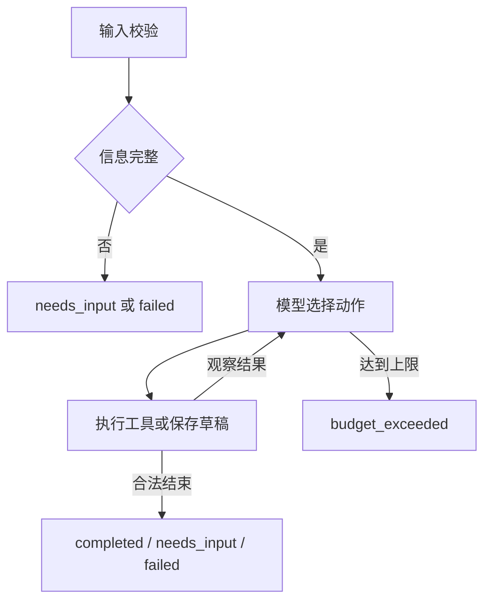

# 实现方案

## 技术选择

使用 Python、LangGraph StateGraph、Pydantic 和 HTTPX。验证环境的 LangGraph 版本为 1.2.18，完整依赖快照见 [requirements-lock.txt](../requirements-lock.txt)。

LangGraph 负责状态传递、节点执行和条件路由；模型负责选择业务动作。Pydantic 校验输入、动作和脚本结构；HTTPX 调用 Chat Completions 兼容服务。素材与规则使用本地 JSON，便于离线验证，暂不引入向量数据库。

项目采用一个决策 Agent，写稿与改稿共用入口，减少协调成本。原生实现也可以满足需求，选择 StateGraph 是为了明确表达状态与循环边界。

## 调用流程

代码主要位于 [runtime.py](../src/short_video_agent/runtime.py)。Mock 使用固定策略及模板，Live 由模型读取当前状态与 Trace 后返回动作。框架路由负责循环及退出，不替模型决定查询改写和脚本内容。

## 动作协议

动作由 schemas.py 中的 Action 校验，包含 name、reason，以及动作需要的 query 或 draft。这里使用普通 Pydantic 模型和校验器，没有使用 discriminated union。

| name | 参数 | 执行结果 |
| --- | --- | --- |
| search_materials | query | 按请求中的 product_id 检索并合并素材 |
| save_draft | 完整 draft | 保存新版本，清空旧估时和规则报告 |
| estimate_duration | 无 | 当前草稿逐镜与总时长 |
| check_rules | 无 | 事实引用、品牌和节奏检查，必要时追加文案审核 |
| request_info | 无 | needs_input，reason说明需补充的信息 |
| finish | 无 | 门禁通过后completed，否则错误反馈模型 |
| fail | 无 | failed，reason说明原因 |

工具异常在 Live 中作为观察反馈，允许模型选择下一步；Mock 的工具异常直接失败。模型连接错误直接失败，非法结构输出消耗预算并反馈下一轮。

## 工具与事实检查

- retrieval.py：先按产品过滤，再按关键词与事实、产品名称匹配打分。
- duration.py：旁白和字幕分别按每秒4个字或字符估时，取较大值与最低画面时长比较，逐镜加0.5秒停顿。目标时长作为上限。
- rules.py：检查事实来源、同镜头引用对应、缺少引用、禁用词、重复文案和额外停留。

产品事实须引用素材中的 material_id 和 fact_id，事实文本须在本镜头的至少一个可见字段中原样出现。Live 的白名单外文案触发额外模型审核，检查新增事实、用户要求适配和字幕旁白矛盾。它只可解除原创文本未批准问题，不能解除确定性规则发现的其他错误。

审核使用同一模型的另一请求，可能漏判，不能代替人工事实核查。Mock 继续使用固定白名单模板。

## 状态、版本和预算

状态用 TypedDict 保存输入、素材、规则、当前草稿、估时、检查、动作、Trace和任务状态。仅保存当前草稿；Live历史版本可从Trace中save_draft的完整参数还原，没有单独草稿列表或断点恢复。

policy.py 在完成前检查：当前草稿哈希与两个报告一致、素材和规则快照一致、规则通过、总估时不超过上限。改稿使旧报告失效，重新检索使规则报告失效。

CLI默认max_steps为10，可设1至100；Web限定1至30。Live每次决策计一次预算，原创文案审核额外计一次。没有分别统计模型与工具调用上限。总时间预算默认180秒，在模型请求前后检查；单次HTTP超时默认45秒，不会在总期限到达时立即取消正在进行的请求。图递归上限为额外兜底。

## 导入、Trace和导出

CLI的--draft接受title和scenes，校验后初始化revision=1并估时；导入事件标为user，记录草稿和初始估时。它不代表模型生成的首稿。

普通动作Trace记录step、actor、action、arguments、reason和observation。模型非法输出及连接错误记录相应错误事件，字段比普通动作少；没有逐事件时间戳或耗时统计，不记录模型内部思维过程。

导出模块保存input.json、result.json、script.md、checks.json、trace.jsonl、manifest.json。未完成状态也保留已有结果，密钥不进入这些导出字段。CLI补充信息后需重新运行，没有parent_run_id或交互暂停。

## 运行入口与限制

CLI与本地Web共用runtime和导出逻辑。Web仅监听127.0.0.1，一次执行一个任务，页面轮询结果。暂不支持任务取消、上传素材和在线编辑。

真实模型路径、失败案例和取舍验证见 [评估文档](03-evaluation.md)，逐项材料见 [验收索引](06-acceptance.md)。
